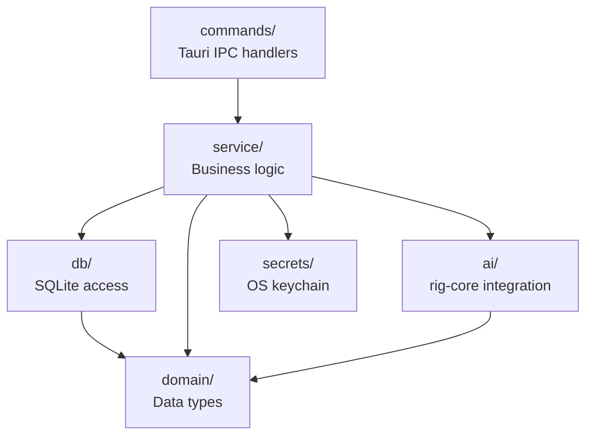
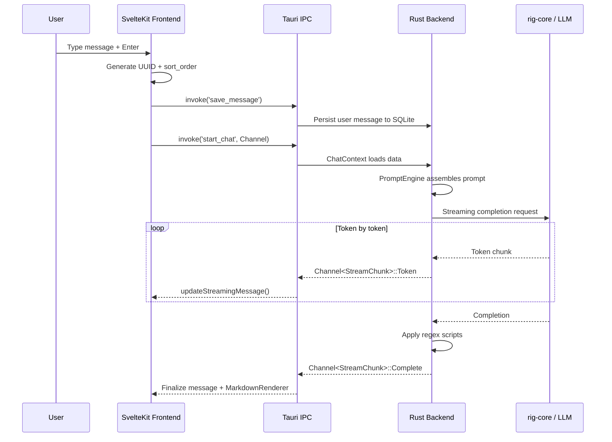

<!-- Revelry Design Specification v2.0 — Section 6 -->
<!-- Last updated: 2026-05-20 -->

# System Architecture

## High-Level Architecture

Revelry uses a two-process architecture: a SvelteKit SPA running in Tauri's native webview (frontend process) communicating with a Rust backend (backend process) through Tauri's IPC layer. The frontend handles all UI rendering and local state management; the backend handles data persistence, AI inference, secret storage, and file operations.

```mermaid
graph LR
    subgraph Frontend["Frontend (SvelteKit SPA)"]
        UI[Svelte Components]
        State[AppState<br/>$state runes]
        Types[TypeScript Types]
    end

    subgraph IPC["Tauri IPC"]
        Invoke[invoke&#40;&#41;<br/>request/response]
        Channel[Channel&lt;T&gt;<br/>streaming]
    end

    subgraph Backend["Backend (Rust + Tauri)"]
        Commands[commands/]
        Service[service/]
        DB[db/]
        Domain[domain/]
        AI[ai/]
        Secrets[secrets/]
    end

    UI --> State
    State --> Invoke
    State --> Channel
    Invoke --> Commands
    Channel --> Commands
    Commands --> Service
    Service --> DB
    Service --> AI
    Service --> Secrets
    DB --> Domain
    Service --> Domain
```



**Communication patterns:**

- `invoke()` for request/response operations (CRUD, configuration, search)
- `Channel<T>` for streaming operations (AI token-by-token responses)

The frontend pre-generates message UUIDs and sort_order before sending to the backend, ensuring atomic persistence even if the connection is interrupted.

## Frontend Architecture

### Central State: AppState

All application state lives in a single reactive class (`AppState`) exported as a singleton `app` from `src/lib/stores/app.svelte.ts`. This follows an Elm-inspired single source of truth pattern, implemented with Svelte 5 runes:

- `$state()` fields: `characters`, `personas`, `conversations`, `providers`, `prompt_presets`, `messages`, `active_conversation_id`, `is_generating`, `sidebar_open`, `character_search_query`
- Derived getters: `active_conversation`, `active_character`, `active_persona`, `default_persona`, `filtered_characters`
- Action methods: `hydrate()`, `openConversation()`, `appendMessage()`, `updateStreamingMessage()`, `toggleSidebar()`, `switchPersona()`

Components import `app` and read/write state directly. No event bus or message dispatch layer is needed — Svelte's reactivity system handles UI updates automatically when state changes.

### Component Module Structure

```
src/lib/components/
├── ui/          Headless UI primitives (Avatar, Button, Dialog, Input, etc.)
├── layout/      App shell components (AppHeader, ConversationSidebar)
├── chat/        Chat-specific (ChatHeader, MessageBubble, MessageInput, MarkdownRenderer, etc.)
├── characters/  Character management (CharacterCard, CharacterEditorDialog, etc.)
├── personas/    Persona management (PersonaCard, PersonaEditorDialog)
├── lorebooks/   Lorebook management (LorebookCard, LorebookEditor)
├── providers/   Provider configuration (ProviderEditorDialog, ModelEntryRow)
└── settings/    Settings (ThemeToggle, PresetEditorDialog)
```

### Routing

SvelteKit file-based routing provides navigation:

| Route         | Purpose                                         |
| ------------- | ----------------------------------------------- |
| `/`           | Welcome page with suggested characters          |
| `/chat/[id]`  | Active conversation view with streaming         |
| `/characters` | Character and persona library with tabs         |
| `/settings`   | Provider config, generation params, preferences |

### State Hydration

The root layout (`+layout.svelte`) calls `app.hydrate()` at startup, loading initial data (characters, personas, conversations, providers, presets) from the Tauri backend via `invoke()` calls. Subsequent data loads happen on-demand when navigating to specific views.

## Backend Architecture

The Rust backend is organized into layered modules within `src-tauri/src/`:



### commands/ — Tauri IPC Handlers

Each module exposes `#[tauri::command]` functions that the frontend calls via `invoke()`:

| Module          | Key Commands                                                                                                             |
| --------------- | ------------------------------------------------------------------------------------------------------------------------ |
| `app_settings`  | get_app_setting, set_app_setting                                                                                         |
| `avatars`       | upload_avatar, delete_avatar                                                                                             |
| `card_io`       | import_card, export_card                                                                                                 |
| `characters`    | get_characters, save_character, delete_character, search_characters                                                      |
| `chat`          | start_chat, stop_generation, regenerate, edit_and_resend                                                                 |
| `conversations` | get_conversations, start_conversation, delete_conversation, fork_conversation, get_branches_for_message, search_messages |
| `keywords`      | test_lorebook_keywords                                                                                                   |
| `lorebooks`     | get_lorebooks, save_lorebook, assign_lorebook_to_character, get_conversation_lorebooks                                   |
| `personas`      | get_personas, save_persona, delete_persona                                                                               |
| `presets`       | get_presets, save_preset, delete_preset                                                                                  |
| `providers`     | get_providers, save_provider, save_api_key, has_api_key, check_keyring_available                                         |
| `regex`         | get_regex_scripts, save_regex_script, apply_single_regex, validate_regex_pattern                                         |

### service/ — Business Logic

| Module        | Responsibility                                                                                                                               |
| ------------- | -------------------------------------------------------------------------------------------------------------------------------------------- |
| `prompt`      | PromptEngine: assembles system prompt, character data, lorebook entries, persona data, and conversation history with budget-aware truncation |
| `lorebook`    | Lorebook service: recursive keyword matching with LorebookActivation role filtering                                                          |
| `regex`       | Regex script engine: ordered pipe-chain application with ReDoS protection via size_limit                                                     |
| `card_io`     | Character card import/export (PNG V2 tEXt chunks, JSON)                                                                                      |
| `template`    | Template variable resolution ({{user}}, {{char}}, etc.)                                                                                      |
| `token_count` | BPE tokenization via tiktoken-rs                                                                                                             |

### db/ — SQLite Access Layer

The `DbWorker` runs on a dedicated background thread, receiving operations via `tokio::sync::mpsc` channels. Database modules include: `app_settings`, `characters`, `conversations`, `generation`, `lorebook`, `migrations`, `models`, `personas`, `providers`, `regex_scripts`. A single collapsed migration handles all schema creation (no data to preserve in initial release).

### domain/ — Data Types

Rust structs with `serde` serialization that mirror the SQLite schema and are serialized to JSON for IPC transport to the frontend. Types include: `character`, `conversation`, `generation`, `lorebook`, `persona`, `provider`, `regex_script`.

### ai/ — AI Provider Integration

Uses rig-core 0.37 to construct provider clients via builder pattern. The `start_chat` command creates a `ChatContext` that loads character, persona, and history data, then uses `PromptEngine` to assemble the full prompt before streaming via rig-core's completion API.

### secrets/ — OS Keychain

Wraps the keyring v4 crate for storing API keys in the OS-native credential store. Uses `use_native_store(true)` at init and `release_store()` at shutdown.

## Data Flow: Chat Interaction

The following describes the complete data flow when a user sends a message in an active conversation:

1. User types message in `MessageInput` and presses Enter
2. Frontend generates UUID + sort_order for the new message
3. Frontend calls `invoke('save_message', { message })` to persist the user message
4. Frontend calls `invoke('start_chat', { conversation_id, channel })` with a Tauri `Channel<StreamChunk>`
5. Backend `ChatContext` loads: character data, active persona, conversation history, lorebook entries
6. `PromptEngine` assembles the full prompt with budget-aware context management
7. `AiService` initiates streaming completion via rig-core
8. Token chunks are sent through the `Channel<StreamChunk>` back to the frontend
9. Frontend `app.updateStreamingMessage()` appends each token to the active message
10. On completion, `StreamChunk::Complete` includes token usage and lorebook activation details
11. Regex scripts are applied to the completed response before final display
12. `MarkdownRenderer` renders the completed message with GFM formatting and syntax highlighting


